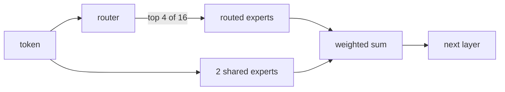

# MoE from scratch

[](https://github.com/tanishvora-netizen/moe-from-scratch/actions/workflows/tests.yml)

A small Mixture-of-Experts (MoE) language model built from scratch in PyTorch, with a custom Triton GPU kernel
and an experiment comparing three ways to keep the experts load-balanced.

- **Model:** a ~7M-parameter decoder in the DeepSeek-MoE style: 16 small routed experts per layer (each token
  uses 4) plus 2 shared experts that every token uses.
- **Kernel:** a Triton grouped-GEMM kernel, forward and backward, that runs all 16 experts in one launch
  instead of a Python loop over experts.
- **Experiment:** Switch-style auxiliary loss vs DeepSeek-V3's auxiliary-loss-free bias vs expert-choice
  routing, compared against a dense model that does the same compute per token.
- **Analysis:** which tokens each expert ends up specializing in.

## How an MoE layer works

A normal transformer layer sends every token through one feed-forward network (FFN). An MoE layer replaces it
with many small FFNs ("experts") and a router that sends each token to only a few of them. The model gets more
total parameters while the compute per token stays the same.



The hard part is **load balancing**: left alone, the router sends most tokens to a few favorite experts and the
rest never learn. This repo compares three fixes for that.

| | MoE (default) | Dense baseline |
|---|---|---|
| d_model / layers / heads | 256 / 6 / 8 | 256 / 6 / 8 |
| FFN | 16 routed experts (hidden 64), top-4, + 2 shared | SwiGLU, hidden 384 |
| Total params | ~7.0M | ~3.4M |
| Active params per token | ~3.4M | ~3.4M |

The dense FFN width is chosen so both models do the same compute per token, so the comparison isolates what the
extra (inactive) expert capacity buys.

## Quick start

Works on any machine. The Triton kernel needs an NVIDIA GPU, and everything else falls back to plain PyTorch.

```bash
git clone https://github.com/tanishvora-netizen/moe-from-scratch.git
cd moe-from-scratch
pip install -e ".[all]"

pytest -q   # kernel + model tests; without a GPU the kernel runs in Triton's CPU interpreter
python scripts/train.py --dataset shakespeare --steps 200 --batch_size 16 --eval_interval 100 --impl naive
```

## Full experiment (one GPU)

Any single A10 / L4 / 4090 / A100 / H100 is enough.

```bash
pip install -e ".[all]"
python scripts/benchmark.py        # Triton vs naive loop vs dense: correctness + timings
bash scripts/run_ablations.sh      # dense + 3 routers, then comparison plot and expert analysis
```

Or one run at a time:

```bash
python scripts/train.py --name dense             --ffn dense
python scripts/train.py --name moe_aux_loss      --router aux_loss
python scripts/train.py --name moe_aux_free      --router aux_free
python scripts/train.py --name moe_expert_choice --router expert_choice
python scripts/plot_runs.py runs/dense runs/moe_aux_loss runs/moe_aux_free runs/moe_expert_choice
python scripts/analyze_experts.py --ckpt runs/moe_aux_free/ckpt.pt
python scripts/sample.py --ckpt runs/moe_aux_free/ckpt.pt --prompt "Once upon a time"
```

Defaults: TinyStories (first 200 MB), byte-level tokens, sequence length 256, batch 64, 5000 steps (~82M tokens),
AdamW with a cosine schedule, bf16 autocast. Use `--data_dir` to train on any pre-tokenized directory.

## Project layout

```
moe/
  config.py      all hyperparameters (ModelConfig)
  layers.py      RMSNorm, causal attention with RoPE, SwiGLU
  router.py      the three routing strategies -> one shared (token, expert) layout
  kernels.py     Triton grouped-GEMM kernels + autograd wrapper
  moe_layer.py   the MoE layer, with a Triton path and a naive reference path
  model.py       full transformer, parameter counting, checkpoint loading
  data.py        Shakespeare / TinyStories download and tokenization
scripts/
  train.py             training loop; logs to runs/<name>/metrics.jsonl
  benchmark.py         correctness check + timings: naive vs Triton vs dense
  analyze_experts.py   expert specialization heatmaps + mutual-information score
  plot_runs.py         ablation comparison plot
  sample.py            generate text from a checkpoint
  run_ablations.sh     the full experiment
  smoke_test.sh        one-minute check on any machine
tests/           kernel, layer, and end-to-end training tests (run in CI on every push)
```

## How the Triton kernel works

After routing, each token has k (token, expert) assignments. The expert computation is:

```
router -> sort assignments by expert -> grouped GEMM #1 (x @ W_gate_up[e], gather fused)
       -> SwiGLU -> grouped GEMM #2 (@ W_down[e]) -> scale by gate weight, add back to each token
```

**Naive path** (`--impl naive`): a Python loop over experts, each doing a gather, two small matmuls and a
scatter. With 16 experts that's over a hundred small kernel launches per layer plus a host sync, and the GPU
mostly sits idle.

**Triton path** (`moe/kernels.py`): one launch covers every expert.

- Each program computes a 64-row × BLOCK_N output tile. Tiles never cross an expert boundary, so each tile loads
  only one expert's weights.
- A **tile schedule** maps each tile to (expert, row range). It is built on the GPU with `searchsorted` and
  launched with an upper bound on the tile count, so there is **no host sync**. Extra tiles exit immediately.
- The **gather is fused**: tiles read token rows straight from the un-permuted activations, so the permuted
  copy is never written to memory.
- **Backward is Triton too:** `dX` reuses the forward kernel with the weights read transposed through strides,
  and `dW[e] = Xₑᵀ dYₑ` uses a second kernel that reduces over each expert's rows.
- Block sizes, warps and stages are autotuned per shape.

## The load-balancing experiment

| `--router` | How it balances | Source |
|---|---|---|
| `aux_loss` | softmax top-k, plus a loss `E · Σ fₑ·Pₑ` (weight 0.01) that penalizes uneven load | Switch Transformer / GShard |
| `aux_free` | sigmoid scores; a per-expert bias is added **only when picking** experts and nudged by ±γ each step toward under-loaded experts; no extra loss | DeepSeek-V3 |
| `expert_choice` | each expert picks its top-C tokens, so load is perfectly even by construction | Zhou et al. 2022 |

**Caveat for expert choice in a language model:** whether a token gets picked depends on the scores of the
*other* tokens in the batch, including later ones in the same sequence. Training is not strictly causal, so
its validation loss looks better than it really is. `train.py` also logs `val_loss_token_choice` for these runs,
which re-evaluates the same model with causal per-token top-k routing. The gap between the two numbers measures
how much the model was "peeking".

Logged to `runs/<name>/metrics.jsonl`:

- `val_loss` (and `val_loss_token_choice` for expert choice), on fixed validation windows so runs are comparable
- `maxvio` = (max expert load − mean load) / mean load, averaged over layers (0 = perfectly balanced), the
  metric used in the auxiliary-loss-free paper
- `loads`: per-layer expert load fractions
- `dropped_frac` (expert choice only): fraction of tokens that got no routed expert
- `tok_per_s`: training throughput

`analyze_experts.py` adds a normalized mutual information score, I(token; expert) / H(expert), per layer: one
"how specialized are the experts" number to compare across routers. With byte-level tokens the heatmaps are easy
to read: look for experts that specialize in spaces, vowels, capitals or punctuation.

## Status and next steps

- [x] Model, three routers, Triton forward + backward kernels, naive reference path
- [x] Tests: kernel vs PyTorch reference, Triton vs naive layer, end-to-end training (CI on every push)
- [ ] Full ablation on a GPU, with results and plots added here
- [ ] Expert-specialization analysis of the trained checkpoints
- [ ] Kernel: fuse SwiGLU into GEMM #1's epilogue, and the gate-scale + scatter-add into GEMM #2's
- [ ] Try the auxiliary-loss-free bias trick outside MoE, e.g. to balance slot usage in learned hash-table
      encoders, where many inputs competing for the same slot is the same problem as tokens piling onto one expert

## References

- Fedus, Zoph, Shazeer. [Switch Transformers](https://arxiv.org/abs/2101.03961). 2021.
- Lepikhin et al. [GShard](https://arxiv.org/abs/2006.16668). 2020.
- Dai et al. [DeepSeekMoE](https://arxiv.org/abs/2401.06066). 2024.
- Wang et al. [Auxiliary-Loss-Free Load Balancing Strategy for Mixture-of-Experts](https://arxiv.org/abs/2408.15664). 2024.
- DeepSeek-AI. [DeepSeek-V3 Technical Report](https://arxiv.org/abs/2412.19437). 2024.
- Zhou et al. [Mixture-of-Experts with Expert Choice Routing](https://arxiv.org/abs/2202.09368). 2022.
- Eldan, Li. [TinyStories](https://arxiv.org/abs/2305.07759). 2023.
